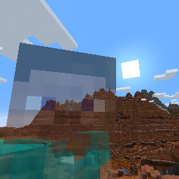
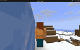

# Camera Entity Fade

Fades the camera entity when it gets too close to the camera.

This client-side mod uses the active perspective's `third_person` trait from [Perspective API](https://github.com/Leawind/Perspective-API) to decide when camera-entity fading applies.

## License

[MIT](LICENSE.txt)
